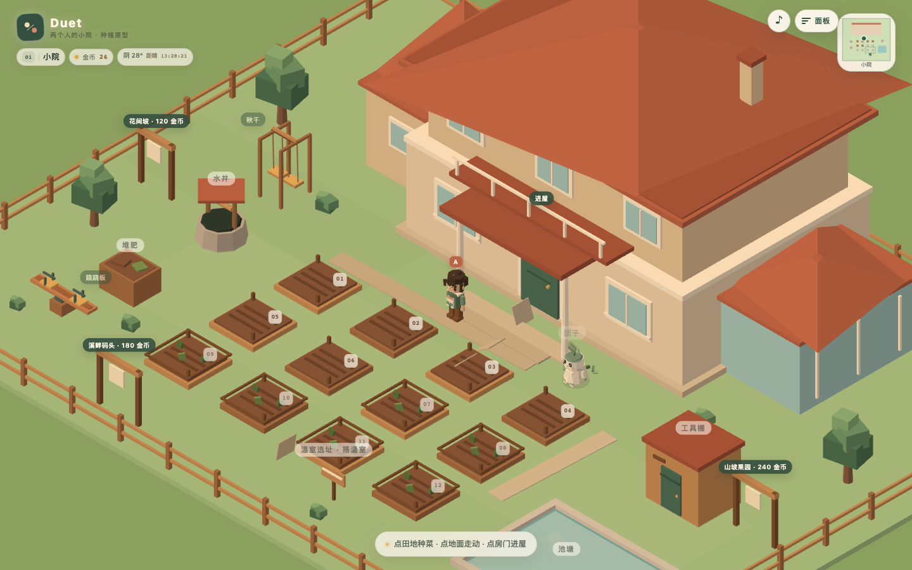
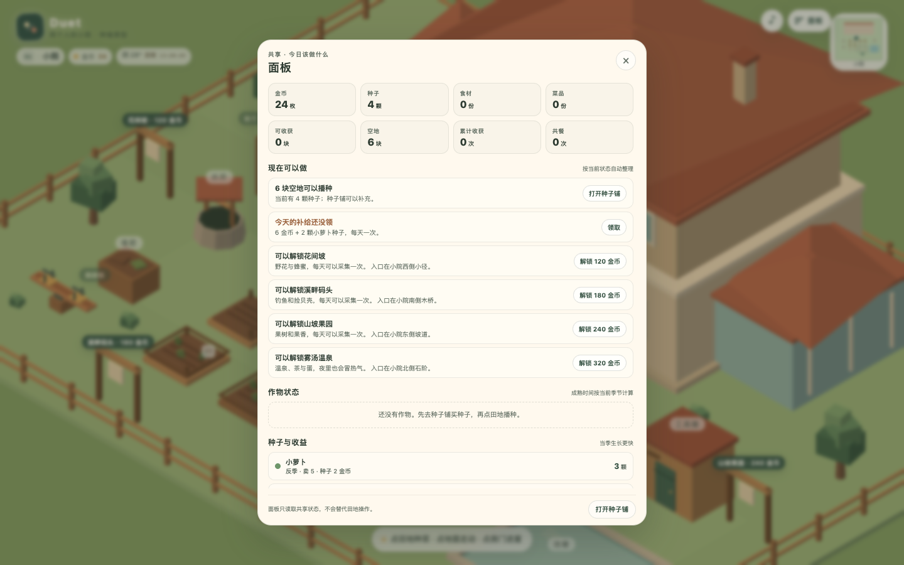
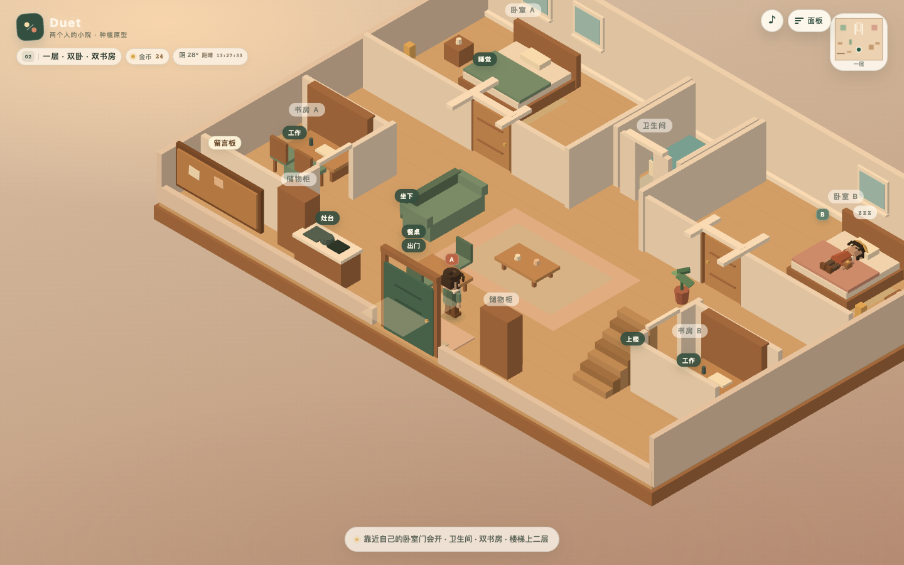
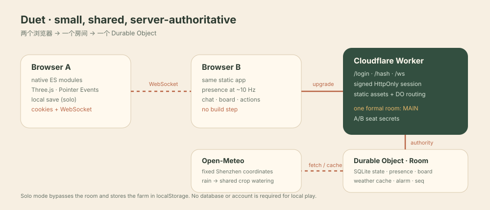
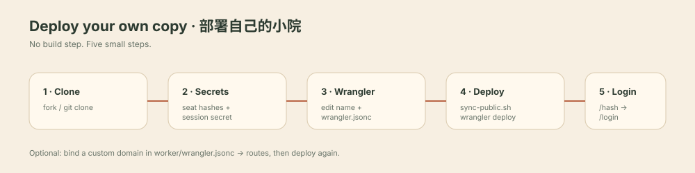

<p align="center">
  
</p>

<h1 align="center">Duet · 两个人的小院</h1>
<p align="center"><a href="docs/assets/duet-intro-15s.mp4"><strong>▶ 观看 15 秒介绍片 / Watch the 15s intro</strong></a></p>
<p align="center"><strong>A quiet 2.5D shared farm for two people.<br/>一座给两个人的 2.5D 共享小院。</strong></p>

<p align="center">
  <a href="#中文">中文</a> ·
  <a href="#english">English</a> ·
  <a href="#deploy-to-cloudflare">Deploy / 部署</a> ·
  <a href="#tests">Tests / 测试</a>
</p>

---

## 中文

### 这是什么

Duet 是一个**两个人一起照料同一座小院**的低压力养成游戏。没有排行榜，没有每日打卡压力，只有一块田、一栋小屋、三餐和对方。

- 固定 45° 等距视角；点地面走路，点门进屋；原生 ES Modules，不需要构建。
- 12 块田、3 种作物、种子铺、温室、杂草/虫害、季节与真实天气。
- 一层厨房：收获留下食材 → 灶台做菜 → 餐桌共餐 → 给对方留饭。
- 双人秋千、跷跷板、沙发、书房、卧室；一层有厨房/餐厅/留言板。
- 房间模式由 Cloudflare Worker + 一个 Durable Object 做权威；两人完全对等。
- 单机模式完全离线，存档在本机 `localStorage`。
- 默认角色名是占位的 **A / B**；没有内置改名 UI，名字在 `src/config.js` 中修改。

<p align="center">
  
  
</p>

### 快速开始（单机）

需要 Python 3（或任意静态文件服务器）：

```bash
python3 -m http.server 4173
# 打开 http://127.0.0.1:4173/?solo=1
```

> 不能直接双击 `index.html`：浏览器会阻止 `file://` 下的 ES Module 加载。

单机存档键为 `duet.farm.v3`，只保存在你自己的浏览器里。公开仓库不含任何个人存档或昵称。

### 操作

- **点地面**：走路；**点门/楼梯**：先走过去再切换场景。
- **点田地**：打开田地卡；播种、浇水、收获、清理。
- **面板**（右上）：今日任务、作物、种子、厨房、仓库、场景解锁。
- **灶台**：走近后点灶台；做菜、卖菜、留饭。
- **餐桌**：点桌坐下/开饭；点椅子起身。
- **房间模式**：左下角聊天；HUD 显示连接状态和延迟。

### 架构

<p align="center"></p>

```text
Browser A ─┐
           ├─ WebSocket ─ Cloudflare Worker ─ Durable Object (Room)
Browser B ─┘                              ├─ SQLite: plots / stats / inventory / world
                                           ├─ presence / chat relay
                                           ├─ board (180 days)
                                           └─ Shenzhen weather cache → RAIN_WATER
```

- 客户端只发送操作意图，DO 校验/应用后广播权威 `state`。
- 单人模式使用同一个纯 `reducer`，不依赖 `src/net/`。
- Three.js 锁定 `0.160.0`；没有贴图、模型、音频或图片资产。
- 天气固定深圳（`HOME_LOCATION`），真实下雨会给室外作物浇水；DO 在空房时也会每 5 分钟检查。

### 部署到自己的 Cloudflare

> 下面是从零部署的完整流程。不要把 `worker/.dev.vars`、个人存档、真实密语提交到仓库。

#### 1. 前置条件

- 一个 Cloudflare 账号（Durable Objects 需要 Workers 付费计划或可用额度）
- Node.js 18+、`npx wrangler`
- 可选：一个域名（`workers.dev` 在中国大陆经常不可达，长期使用建议自定义域名）
- 如果账号里已经有名为 `duet` 的 Worker，先改 `worker/wrangler.jsonc` 里的 `name`

```bash
git clone https://github.com/EricJiang1329145/duet.git duet
cd duet
npm test          # 可选：161 条纯逻辑测试
```

#### 2. 生成密语摘要和会话密钥

先想好 A/B 两个密语词（可以不同）。用仓库自带的 `seatWord` 生成摘要：

```bash
node --input-type=module -e "import { hashSeatWord } from './src/game/seatWord.js'; console.log(await hashSeatWord('YOUR_WORD_A'))"
node --input-type=module -e "import { hashSeatWord } from './src/game/seatWord.js'; console.log(await hashSeatWord('YOUR_WORD_B'))"
```

复制两段 64 位摘要，后面写入 Worker secret。再生成会话密钥：

```bash
openssl rand -hex 32
```

#### 3. 登录 Wrangler 并写入 secrets

```bash
npx wrangler login
npx wrangler secret put SEAT_A_HASH --config worker/wrangler.jsonc
npx wrangler secret put SEAT_B_HASH --config worker/wrangler.jsonc
npx wrangler secret put SESSION_SECRET --config worker/wrangler.jsonc
```

`SESSION_SECRET` 至少 16 字符，建议 32 字节随机值。三个 secret 只存在 Cloudflare，不进入前端。

#### 4. 生成静态资源并部署

```bash
./worker/sync-public.sh
npx wrangler deploy --config worker/wrangler.jsonc
```

部署成功后会得到一个 `https://<worker-name>.<subdomain>.workers.dev` 地址。`public/` 只是 `index.html`、`src/`、`styles/` 的符号链接集合。

#### 5. 自定义域名（推荐）

编辑 `worker/wrangler.jsonc`：

```jsonc
"routes": [
  { "pattern": "duet.example.com", "custom_domain": true }
]
```

把 `duet.example.com` 换成你自己的域名，然后重新部署：

```bash
npx wrangler deploy --config worker/wrangler.jsonc
```

Cloudflare 会自动创建 DNS 记录并签发证书。`workers.dev` 地址仍然保留，方便测试。

#### 6. 第一次进入

1. 打开 `https://你的域名/hash`，分别输入 A/B 密语，拿到摘要（如果还没设置 secret）。
2. 把摘要写入 `SEAT_A_HASH` / `SEAT_B_HASH`。
3. 打开 `/login`，A 输入 A 密语，B 在另一台设备输入 B 密语。
4. 默认角色名是 **A / B**。想换成你们的昵称，改 `src/config.js` 的 `CHARACTERS`，重新部署即可。

#### 本地联调（可选）

```bash
./worker/sync-public.sh
npx wrangler dev --config worker/wrangler.dev.jsonc --port 8787 --local
# 打开 http://127.0.0.1:8787/login
```

本地 `wrangler dev` 需要三个变量，可用 `--var` 或 `.dev.vars`（已被 `.gitignore` 忽略）：

```bash
npx wrangler dev --config worker/wrangler.dev.jsonc --port 8787 --local \
  --var SEAT_A_HASH:<hash-a> \
  --var SEAT_B_HASH:<hash-b> \
  --var SESSION_SECRET:<random>
```

#### 成本与数据

- 一个正式房间 `MAIN`；DO 用 SQLite 保存农场/留言，Hibernation 时休眠。
- 没有 D1、R2、KV 或外部数据库。
- 天气来自 Open-Meteo，固定深圳坐标；不申请浏览器定位。
- 单机模式不连接 Cloudflare，数据只在本地。

### 项目结构

```text
index.html              # 文档壳 + importmap
src/
  config.js             # 场景/动作/角色/天气/布局
  game/                 # 纯规则：reducer、农事、厨房、天气、留言
  net/                  # WebSocket 房间客户端
  render/               # Three.js 表现层
  scenes/               # 小院/室内/温室/四个附加场景
  ui/                   # HUD、面板、灶台、留言板
worker/
  src/index.js          # Cloudflare Worker 入口
  src/room.js           # Durable Object：房间权威
  src/weather.js        # 深圳天气拉取
  wrangler.jsonc        # Worker + DO + assets 配置
tests/                  # node:test 纯逻辑测试
docs/assets/            # README 截图与架构图
```

### 测试

```bash
npm test
# 161 tests, 0 dependencies
```

测试覆盖 reducer、农事、厨房/共餐、留言、天气、寻路、身份、限流、存档清洗等。浏览器验收需要手动或临时 Playwright，不写入项目依赖。

### License

MIT。见 [LICENSE](LICENSE)。

---

## English

### What is Duet?

Duet is a **low-pressure 2.5D shared farm for two people**. There is no leaderboard and no daily grind — just a field, a small house, meals, and each other.

- Fixed 45° isometric camera; tap the ground to walk, tap doors to change scenes.
- 12 plots, 3 crops, seed shop, greenhouse, weeds/pests, seasons and real weather.
- A ground-floor kitchen: harvest ingredients → cook at the stove → share a meal → leave a dish for your partner.
- A swing, seesaw, sofa, studies, bedrooms; a kitchen/dining room and message board on the first floor.
- Room mode is authoritative: Cloudflare Worker + one Durable Object, two equal clients.
- Solo mode is fully offline and stores the farm in `localStorage`.
- Default names are placeholders **A / B**; there is no rename UI. Change `CHARACTERS` in `src/config.js`.

<p align="center">
  
</p>

### Run locally (solo)

```bash
python3 -m http.server 4173
# open http://127.0.0.1:4173/?solo=1
```

> Do not open `index.html` via `file://`; browsers block ES modules there.

The save key is `duet.farm.v3`, local to your browser. This repository contains no personal save or nickname.

### Architecture

<p align="center"></p>

Clients send intents over WebSocket; the Durable Object validates and applies them with the same pure rules used by solo mode, then broadcasts authoritative state. The DO owns SQLite state, presence, the 180-day board, and a cached Shenzhen weather reading.

### Deploy to your own Cloudflare

<p align="center"></p>

1. **Fork/clone** this repo (`git clone https://github.com/EricJiang1329145/duet.git`), then `cd duet`. If your account already has a Worker named `duet`, change `name` in `worker/wrangler.jsonc` first.
2. **Create seat hashes** for your two passphrases:

   ```bash
   node --input-type=module -e "import { hashSeatWord } from './src/game/seatWord.js'; console.log(await hashSeatWord('YOUR_WORD_A'))"
   node --input-type=module -e "import { hashSeatWord } from './src/game/seatWord.js'; console.log(await hashSeatWord('YOUR_WORD_B'))"
   openssl rand -hex 32
   ```

3. **Log in and set secrets**:

   ```bash
   npx wrangler login
   npx wrangler secret put SEAT_A_HASH --config worker/wrangler.jsonc
   npx wrangler secret put SEAT_B_HASH --config worker/wrangler.jsonc
   npx wrangler secret put SESSION_SECRET --config worker/wrangler.jsonc
   ```

4. **Build assets and deploy**:

   ```bash
   ./worker/sync-public.sh
   npx wrangler deploy --config worker/wrangler.jsonc
   ```

5. **Optional custom domain**: edit `routes` in `worker/wrangler.jsonc`, replace `duet.example.com`, and deploy again. Cloudflare creates DNS + TLS automatically.
6. **First login**: open `/hash` if needed, then `/login`; A and B each enter their passphrase. Change the default A/B names in `src/config.js` if you want your own.

Local room development:

```bash
./worker/sync-public.sh
npx wrangler dev --config worker/wrangler.dev.jsonc --port 8787 --local \
  --var SEAT_A_HASH:<hash-a> \
  --var SEAT_B_HASH:<hash-b> \
  --var SESSION_SECRET:<random>
```

### Privacy

- No personal save, nickname, passphrase hash, or Cloudflare secret is committed.
- Default character names are A/B; the public template contains no real names.
- `worker/.dev.vars`, `public/`, `worker/dev-assets/`, and Wrangler caches are ignored.
- Solo data never leaves the browser.

### Tests

```bash
npm test
# 161 tests, zero runtime dependencies
```

### License

MIT. See [LICENSE](LICENSE).
